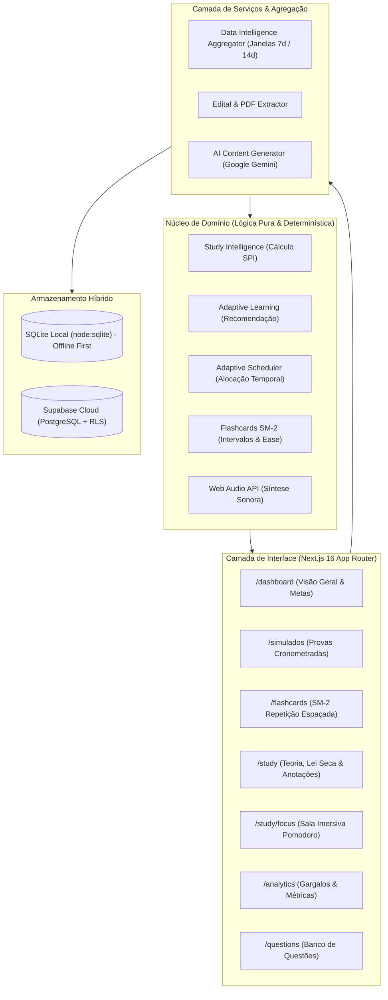

# 🚀 ConcursoOS — Sistema Adaptativo & Inteligente de Preparação para Concursos Públicos

<p align="center">
  
</p>

<p align="center">
  <strong>O sistema operacional definitivo para concurseiros de alta performance.</strong><br>
  O cronograma não dita o seu estudo; seu desempenho real, retenção e histórico de acertos é que ditam o cronograma.
</p>

<p align="center">
  
  
  
  
  
  
  
</p>

---

## 📖 Visão Geral

O **ConcursoOS** é uma plataforma full-stack de preparação para concursos públicos projetada sob os conceitos de **Inteligência de Estudo Determinística** e **Aprendizado Adaptativo**.

Diferente de planilhas estáticas ou cronogramas lineares rígidos, o ConcursoOS calcula matematicamente onde o candidato está perdendo pontos e reorganiza o plano de estudos automaticamente através de métricas de degradação da memória, reincidência de erros e relevância das matérias no edital.

Além disso, a plataforma funciona em **modo híbrido**:
1. **100% Offline e Local:** Armazenamento em SQLite embutido via `node:sqlite`, permitindo estudar sem internet, sem Docker e sem custos de nuvem.
2. **Nuvem com Supabase:** Sincronização PostgreSQL com Row Level Security (RLS) para múltiplos dispositivos.

---

## 🎯 Pilares e Módulos do Sistema

### 1. 🧮 Motor de Inteligência de Estudo — SPI (Spike Priority Index)
O índice SPI calcula matematicamente **O QUE** deve ser estudado primeiro. A fórmula avalia pesos parametrizados:
* **Performance / Gap de Acertos (35%):** Penalidade proporcional à distância da meta (85% de acertos).
* **Tendência Temporal Recente (15%):** Queda de rendimento nas últimas baterias ativa alerta vermelho.
* **Recência / Decaimento de Retenção (15%):** Curva de esquecimento de Ebbinghaus aplicada aos dias sem revisão.
* **Reincidência de Erros (15%):** Erros repetidos no mesmo subtópico geram intervenção prioritária imediata.
* **Relevância no Edital (10%) & Cobertura Teórica (10%):** Peso da disciplina na pontuação total da prova.

### 2. 🧠 Motor Adaptativo de Intervenções
Enquanto o SPI diz *o que* estudar, a engine adaptativa determina **COMO**:
* Se o estudante falha repetidamente em questões conceituais, o sistema recomenda **Revisão Teórica Guiada**.
* Se o estudante tem bom domínio teórico mas decaiu por inatividade, o sistema aciona **Bateria de Questões Rápidas**.
* Histórico com grau de confiança empírico (`STRONG_EVIDENCE`, `MODERATE_EVIDENCE`, `EARLY_SIGNAL`).

### 3. 📅 Adaptive Scheduler (Cronograma Resiliente)
* Distribui a carga horária semanal conforme a disponibilidade real cadastrada pelo usuário.
* **Tolerante a falhas:** Se você não conseguir estudar em um dia, o algoritmo redistribui os tópicos críticos sem acumular uma "bola de neve" inútil de atrasos.

### 4. 🗂️ Flashcards com Repetição Espaçada (SM-2 / Anki)
* Implementação fiel do algoritmo **SuperMemo-2 (SM-2)**.
* 4 níveis de autoavaliação: `Errei (Again)`, `Difícil (Hard)`, `Bom (Good)` e `Fácil (Easy)`.
* Atualização dinâmica de intervalo, repetições consecutivas e Fator de Facilidade (*Ease Factor*).
* Ciclos de vida do card: `NEW` ➔ `LEARNING` ➔ `REVIEW` ➔ `MASTERED`.

### 5. 🎧 Sala Imersiva Zen & Modo Foco (Pomodoro com Áudio Ambiente)
* Temporizador Pomodoro integrado com ciclos de foco (25 min, 50 min) e pausas.
* **Sintetizador Nativo Web Audio API:** Gera sons relaxantes diretamente no navegador sem dependência de streaming ou arquivos MP3 pesados:
  * 🟫 **Ruído Marrom (Brown Noise):** Frequências graves profundas para concentração extrema.
  * 🌧️ **Chuva Suave (Rainfall):** Filtros passa-faixa com ruído rosa modulado.
  * 🌊 **Ondas do Oceano (Ocean Waves):** Modulação senoidal LFO simulando marés contínuas.
  * ⚪ **Ruído Branco (White Noise):** Mascaramento total de ruídos externos.
  * 🧘 Modo tela cheia sem distrações com log de minutos estudados salvo na sessão.

### 6. ⏱️ Modo Simulado & Prova Cronometrada
* Simulação de provas de bancas renomadas (Cebraspe/Cespe, FGV, FCC, Vunesp).
* Cronômetro regressivo com contagem de tempo por questão.
* Gabarito interativo, marcação de dúvidas para revisão posterior e cálculo de nota líquida com penalidade de erro (estilo Cespe Certo/Errado ou múltipla escolha).

### 7. 📚 Teoria Esquematizada, Lei Seca & Caderno de Erros
* **Lei Seca Destacada:** Artigos constitucionais e infraconstitucionais com grifos inteligentes nos trechos mais cobrados e alertas de pegadinhas de bancas.
* **Esquemas Visuais:** Mnemônicos coloridos, mapas mentais, tabelas comparativas e resumos de jurisprudência (Súmulas Vinculantes STF/STJ).
* **Caderno de Erros Automatizado:** Cada questão errada alimenta um banco de revisão ativa com justificativa pedagógica e indicação do artigo violado.

### 8. 📄 Edital Intelligence & Ingestão de Editais
* Extração automatizada de conteúdo programático a partir de arquivos **PDF** via `pdf-parse`.
* Estruturação semântica de disciplinas e tópicos usando **Google Gemini** (`@ai-sdk/google` + Vercel AI SDK).
* Interface de validação humana antes da persistência para garantir 100% de precisão nos tópicos.

### 9. 📊 Candidate Analytics & Dashboard
* Painel de controle com visão de cobertura do edital x aderência ao cronograma x rendimento real.
* Identificação automática do principal gargalo de aprovação (`MAIN_BOTTLENECK`).
* Gráficos de evolução temporal e curva de retenção estimada.

---

## 🏗️ Arquitetura de Software

O ConcursoOS segue os princípios de **Domain-Driven Design (DDD)** e arquitetura limpa:



### Estrutura de Diretórios

```
concurso-os/
├── data/                      # Arquivo do banco de dados SQLite local (concurso.db)
├── docs/                      # Documentação técnica e arquitetural aprofundada
│   ├── ARCHITECTURE.md        # Princípios arquiteturais do projeto
│   ├── ADAPTIVE-LEARNING.md   # Especificação do motor adaptativo
│   ├── CANDIDATE-ANALYTICS.md # Modelagem das métricas do estudante
│   └── STUDY-INTELLIGENCE.md  # Matemática do SPI
├── src/
│   ├── app/                   # Next.js App Router (Páginas, layouts e Server Actions)
│   │   ├── actions/           # Server Actions (simulados, flashcards, focus, etc.)
│   │   ├── analytics/         # Relatórios de desempenho e gargalos
│   │   ├── dashboard/         # Dashboard principal do candidato
│   │   ├── flashcards/        # Interface de estudo por repetição espaçada
│   │   ├── questions/         # Resolução e filtros de questões de concurso
│   │   ├── simulados/         # Provas simuladas com cronômetro
│   │   └── study/             # Teoria, Lei Seca, anotações e Sala Zen
│   ├── components/            # Componentes React reutilizáveis
│   ├── domain/                # Regras de negócio puras (Zero dependências externas)
│   │   ├── adaptive-learning/ # Motor de recomendação de intervenções
│   │   ├── adaptive-scheduler/# Algoritmo de distribuição de horas de estudo
│   │   ├── flashcards/        # Implementação do algoritmo SM-2
│   │   ├── focus/             # Síntese Web Audio API e tipos do Pomodoro
│   │   ├── study-intelligence/# Cálculo do SPI (Spike Priority Index)
│   │   └── theory/            # Banco estruturado de Lei Seca e Mnemônicos
│   ├── lib/
│   │   ├── local-db/          # Cliente e inicializador do SQLite local
│   │   └── supabase/          # Clientes server e browser para Supabase
│   └── services/              # Serviços de integração, agregador de dados e PDF
├── supabase/                  # Migrações SQL e schemas para PostgreSQL
├── public/                    # Assets estáticos
└── package.json               # Dependências e scripts
```

---

## 🛠️ Tecnologias Utilizadas

* **Framework:** [Next.js 16](https://nextjs.org/) (App Router, Server Actions, Turbopack)
* **Linguagem:** [TypeScript](https://www.typescriptlang.org/)
* **UI & Estilos:** [React 19](https://react.dev/), [Tailwind CSS v4](https://tailwindcss.com/), [Lucide React](https://lucide.dev/)
* **Inteligência Artificial:** [Vercel AI SDK](https://sdk.vercel.ai/), [Google Gemini (`@ai-sdk/google`)](https://ai.google.dev/)
* **Banco de Dados Local:** `node:sqlite` nativo (sem dependências C++ ou node-gyp)
* **Banco de Dados Nuvem:** [Supabase](https://supabase.com/) (PostgreSQL 15, RLS)
* **Processamento de Documentos:** `pdf-parse`
* **Testes Automatizados:** [Vitest](https://vitest.dev/) com cobertura de código v8

---

## ⚡ Como Rodar o Projeto

### Pré-requisitos
* **Node.js** v20.x ou superior instalado.
* Gerenciador de pacotes **npm**, **pnpm** ou **yarn**.

### 1. Clonar o Repositório
```bash
git clone https://github.com/rafantavares/concurso-os.git
cd concurso-os
```

### 2. Instalar Dependências
```bash
npm install
```

### 3. Configurar Variáveis de Ambiente
Crie um arquivo `.env.local` na raiz do projeto (opcional para modo 100% offline; obrigatório se for usar IA ou Supabase):

```env
# Banco Local (padrão)
LOCAL_DB_PATH=./data/concurso.db

# Google Gemini (Opcional - para geração de resumos e estruturação de editais)
GOOGLE_GENERATIVE_AI_API_KEY=sua_chave_aqui

# Supabase (Opcional - caso queira sincronizar na nuvem)
NEXT_PUBLIC_SUPABASE_URL=sua_url_supabase
NEXT_PUBLIC_SUPABASE_ANON_KEY=sua_chave_anonima
SUPABASE_SERVICE_ROLE_KEY=sua_chave_service_role
```

### 4. Executar em Modo de Desenvolvimento
```bash
npm run dev
```

Abra seu navegador em [http://localhost:3000/dashboard](http://localhost:3000/dashboard).

> **Dica:** O banco de dados SQLite local é semeado automaticamente na primeira execução com questões de Direito Constitucional, Administrativo, Português, RLM e Informática, além de flashcards e leis secas.

---

## 🧪 Executando os Testes

O projeto conta com uma suíte de testes unitários automatizados cobrindo os motores de inteligência e algoritmos matemáticos:

```bash
# Rodar todos os testes unitários
npm test

# Rodar os testes com relatório de cobertura
npm run test -- --coverage
```

### Cobertura Principal de Testes:
* `src/domain/study-intelligence/spi.test.ts`: Validação dos pesos e desvios de SPI.
* `src/domain/flashcards/sm2.test.ts`: Validação de intervalos, repetições e Ease Factor do algoritmo SM-2.
* `src/services/data-intelligence/aggregator.test.ts`: Janelas móveis temporais de 7 e 14 dias.
* `src/domain/study-intelligence/allocator.test.ts`: Distribuição equilibrada da grade de matérias.

---

## 🔒 Segurança & Boas Práticas

* **Zero Leaks:** Arquivos `.env`, `.env.local`, `.db` e credenciais estão estritamente isolados e protegidos via `.gitignore`.
* **Row Level Security (RLS):** Quando integrado ao Supabase, cada concurseiro possui acesso estritamente restrito aos seus próprios registros e sessões.
* **Resiliência e Fallbacks:** Todas as chamadas para provedores externos de IA contam com fallback graceful determinístico caso a API externa oscile.

---

## 👨‍💻 Autor

Desenvolvido por **Rafael Nunes Tavares**  
* Estudante de Engenharia de Software — Ulbra Palmas  
* GitHub: [@rafantavares](https://github.com/rafantavares)  
* Email: [rafanuntavares@gmail.com](mailto:rafanuntavares@gmail.com)

---

## 📄 Licença

Este projeto é disponibilizado sob a licença [MIT](LICENSE).
